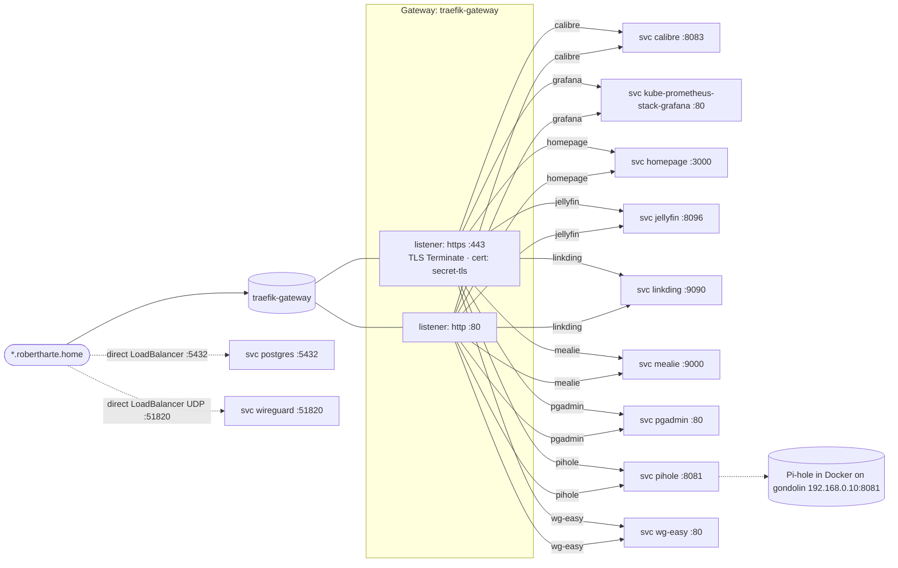

# HTTPRoutes

Gateway API routing topology for the cluster. All routes share a single Traefik-backed
Gateway. No classic `Ingress` resources exist in the cluster; everything is routed
through the Gateway.

## HTTPRoutes

| HTTPRoute | Hostname | Listeners attached (`sectionName`) | Backend |
|-----------|----------|------------------------------------|---------|
| calibre   | calibre.robertharte.home  | http, https | calibre:8083 |
| grafana   | grafana.robertharte.home  | http, https | kube-prometheus-stack-grafana:80 |
| homepage  | homepage.robertharte.home | http, https | homepage:3000 |
| jellyfin  | jellyfin.robertharte.home | http, https | jellyfin:8096 |
| linkding  | linkding.robertharte.home | http, https | linkding:9090 |
| mealie    | mealie.robertharte.home   | http, https | mealie:9000 |
| pgadmin   | pgadmin.robertharte.home  | http, https | pgadmin:80 |
| pihole    | pihole.robertharte.home   | http, https | pihole:8081 → gondolin 192.168.0.10:8081 |
| wg-easy   | vpn.robertharte.home      | http, https | wg-easy:80 |

All routes share the single `traefik-gateway` Gateway
(GatewayClass `traefik`, controller `traefik.io/gateway-controller`).

## Notes

- All nine HTTPRoutes attach to both the `http` (:80) and `https` (:443) listeners.
- **Grafana's HTTPRoute is rendered by the kube-prometheus-stack chart** from
  `grafana.route.main` in its HelmRelease values, not from an `httproute.yaml`.
  See [[Monitoring]].
- **Pi-hole runs outside the cluster**, in Docker on gondolin. Its Service has no
  selector; an EndpointSlice points it at the host's admin port, 192.168.0.10:8081.
  The endpoint must set `conditions.ready: true`, or Traefik skips it and returns
  `503 no available server`.
- **wg-easy** is the WireGuard admin UI and is routed at `vpn.robertharte.home`. The
  VPN itself is not routed through the Gateway: the `wireguard` Service is a
  `LoadBalancer` on UDP `:51820`.
- **PostgreSQL is intentionally not routed through the Gateway.** Its HTTPRoute (and
  Ingress) were removed — Postgres is a raw TCP service and is exposed directly via its
  own `LoadBalancer` Service on `:5432`, with TLS handled by Postgres (`sslmode`).
