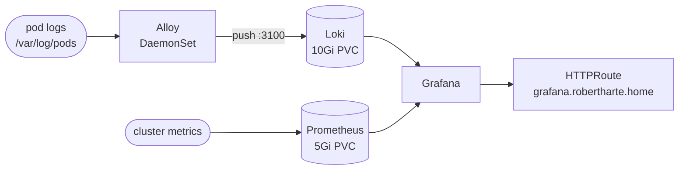

# Monitoring

Metrics and logs for the cluster, all in the `monitoring` namespace and installed as
Flux HelmReleases from `monitoring/controllers/`.



## Components

| Component | Chart | Kind | Storage | Notes |
|-----------|-------|------|---------|-------|
| kube-prometheus-stack | kube-prometheus-stack 84.0.1 | Prometheus, Alertmanager, Grafana | Prometheus 5Gi PVC | HelmRelease in `monitoring/controllers/base/kube-prometheus-stack/` |
| Loki | loki 7.3.0 | StatefulSet `loki`, 1 replica | 10Gi PVC `storage-loki-0` | `SingleBinary` mode, filesystem storage |
| Alloy | alloy 1.13.0 | DaemonSet `alloy` | none | collects pod logs, depends on `loki` |

## Loki

- Runs in `SingleBinary` mode with one replica. The chart's default `SimpleScalable`
  mode needs object storage, which a one-node cluster doesn't have, so the read, write
  and backend replicas are set to 0.
- Logs are kept for **7 days** (`retention_period: 168h`); the compactor enforces this.
- Schema is TSDB `v13` on the filesystem, starting `2026-10-12`. Never edit an existing
  schema entry once logs exist: a schema change is a new entry with a later date.
- Auth is off (single tenant), so clients send no `X-Scope-OrgID` header.
- The memcached caches, the gateway, the canary and the Helm test are disabled to save
  memory. Alloy and Grafana talk to the `loki` Service directly on `:3100`.

## Alloy

- Each pod tails only the pods on its own node, so a second node adds no duplicates.
- Logs get the labels `namespace`, `pod` and `container`, the CRI prefix is stripped,
  and they are pushed to `http://loki.monitoring.svc:3100/loki/api/v1/push`.

## Prometheus

- 5Gi `ReadWriteOnce` PVC on `local-path`.
- Retention is **10 days** (the chart default), capped at `retentionSize: 4GB`. The cap
  sits under the 5Gi claim because a full volume stops Prometheus writing instead of
  pruning old data.

## Grafana

- Served at `grafana.robertharte.home` through the Gateway (see [[HTTPRoutes]]).
- The admin password comes from the SOPS-encrypted `grafana-env` secret
  (`monitoring/configs/staging/kube-prometheus-stack/grafana-env-secret.yaml`, key
  `adminPassword`), loaded with `envFrom`.
- A `Loki` datasource points at `http://loki.monitoring.svc:3100`.

## Verifying Loki

1. In Grafana, open **Connections → Data sources → Loki** and click **Save & test**.
   It should report a successful connection.
2. Open **Explore**, pick Loki, switch to **Code** and run `{namespace="monitoring"}`
   over the last 15 minutes. Log lines should appear.
3. From a shell:

   ```bash
   kubectl get helmrelease -n monitoring
   kubectl get pods,pvc -n monitoring
   kubectl logs -n monitoring ds/alloy -c alloy --tail=100 | grep -iE 'level=(error|warn)'
   ```

## Persistent volumes

All volumes use the default `local-path` storage class, so data lives on gondolin's
disk and does not move between nodes. Deleting a PVC deletes its data.

| Namespace | PVC | Size |
|-----------|-----|------|
| calibre | calibre-config-pvc | 1Gi |
| calibre | calibre-data-pvc | 2Gi |
| database | postgres-data-pvc | 8Gi |
| jellyfin | jellyfin-cache-pvc | 200Mi |
| jellyfin | jellyfin-config-pvc | 100Mi |
| jellyfin | jellyfin-media-pvc | 1Gi (static PV `jellyfin-media-pv`) |
| monitoring | prometheus-…-prometheus-0 | 5Gi |
| monitoring | storage-loki-0 | 10Gi |
| wireguard | wireguard-config-pvc | 128Mi |
